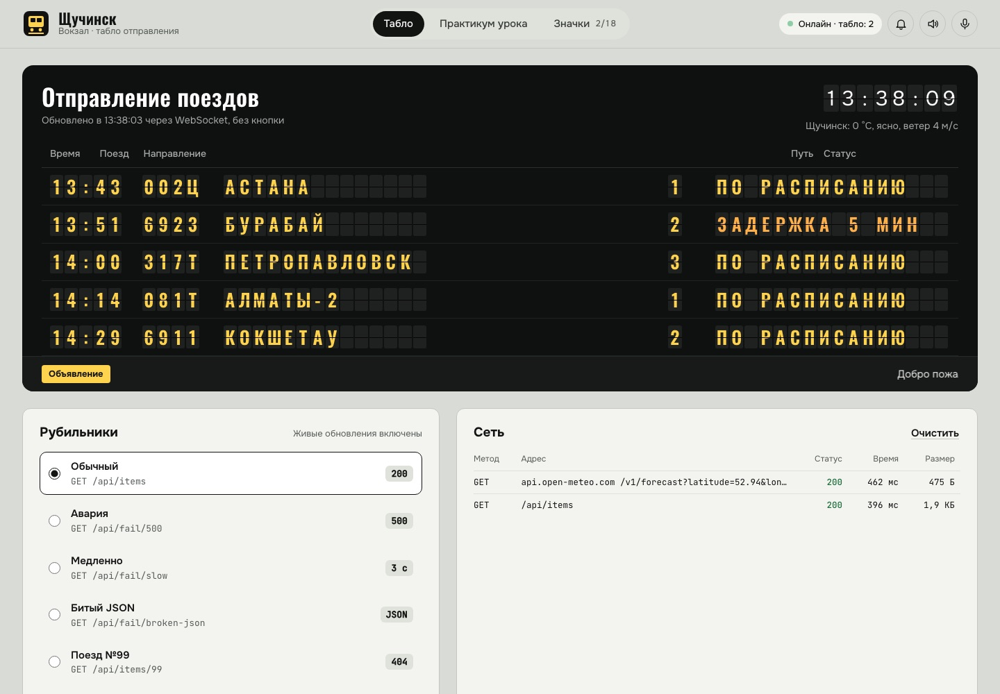
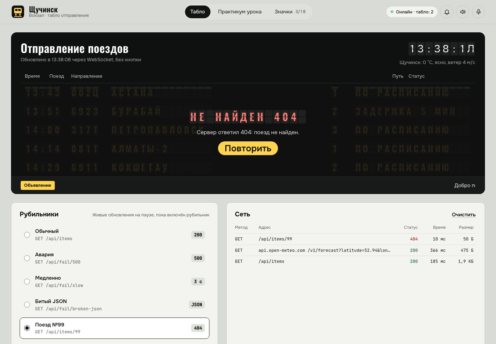
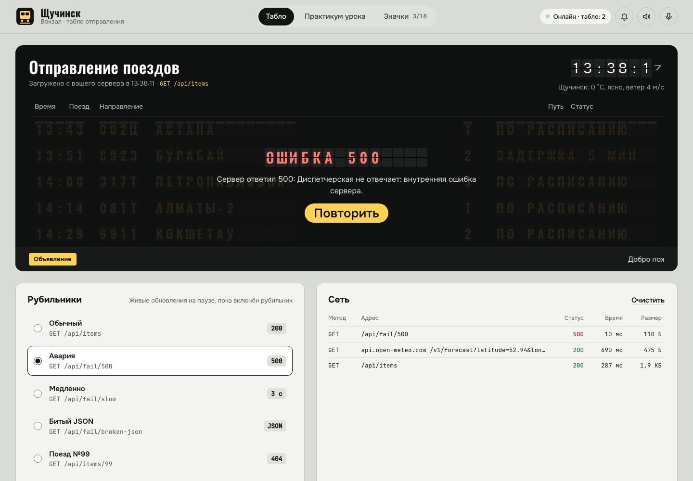
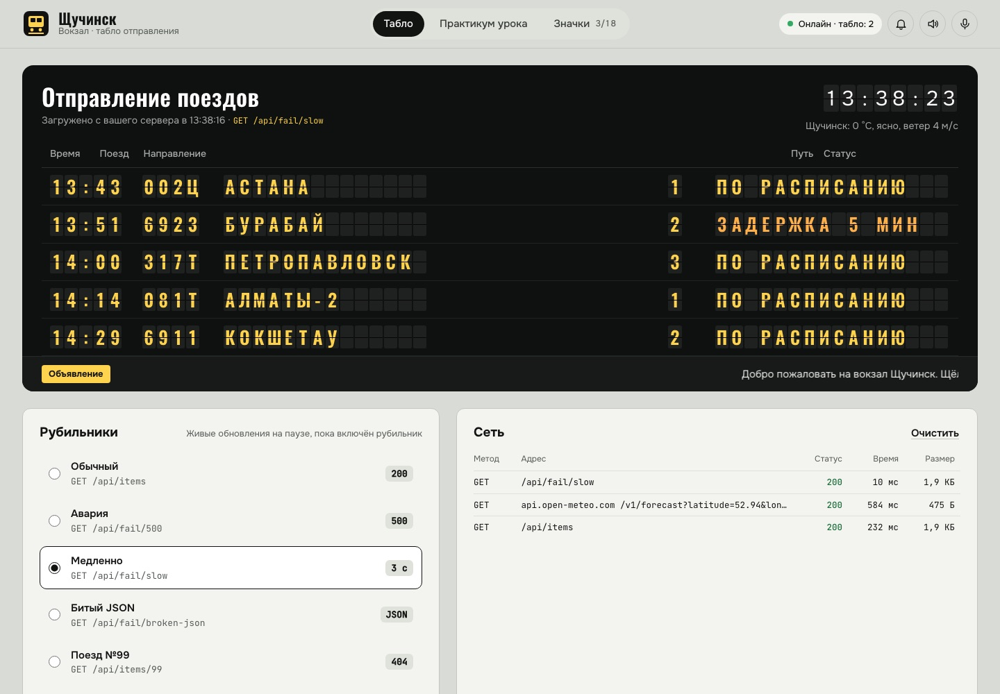
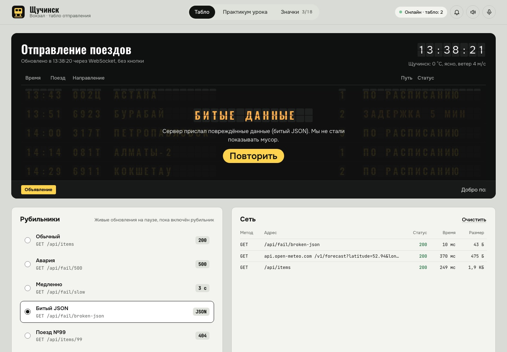
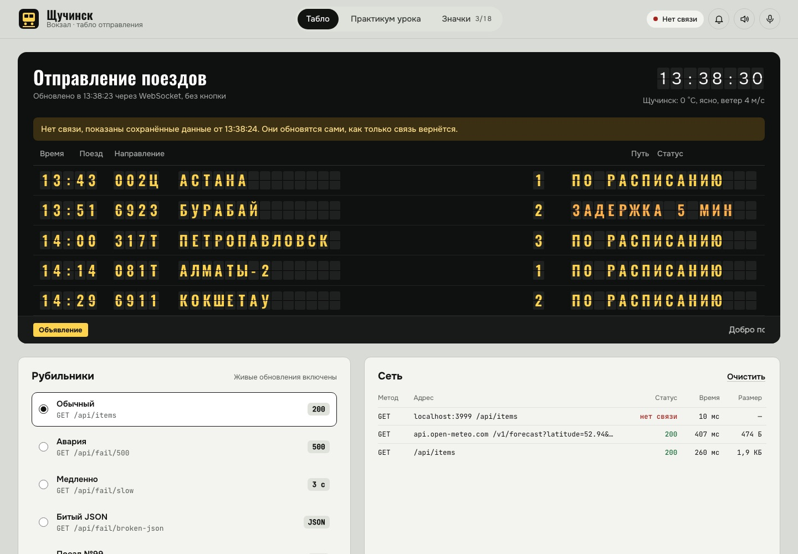
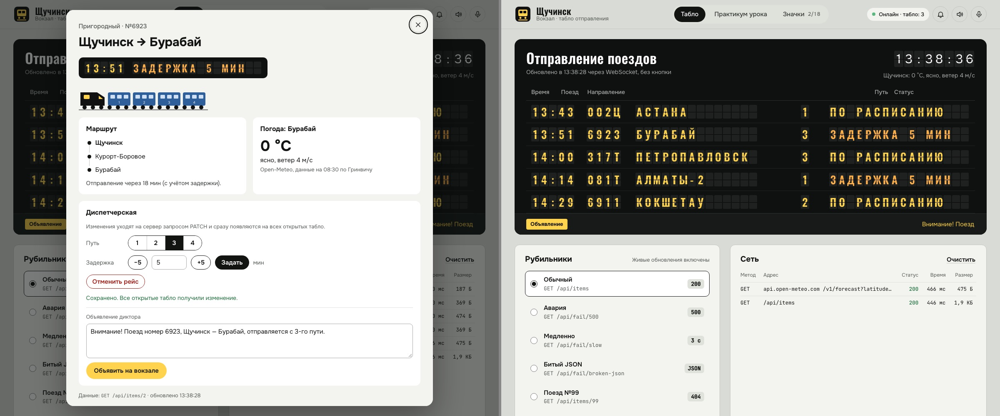
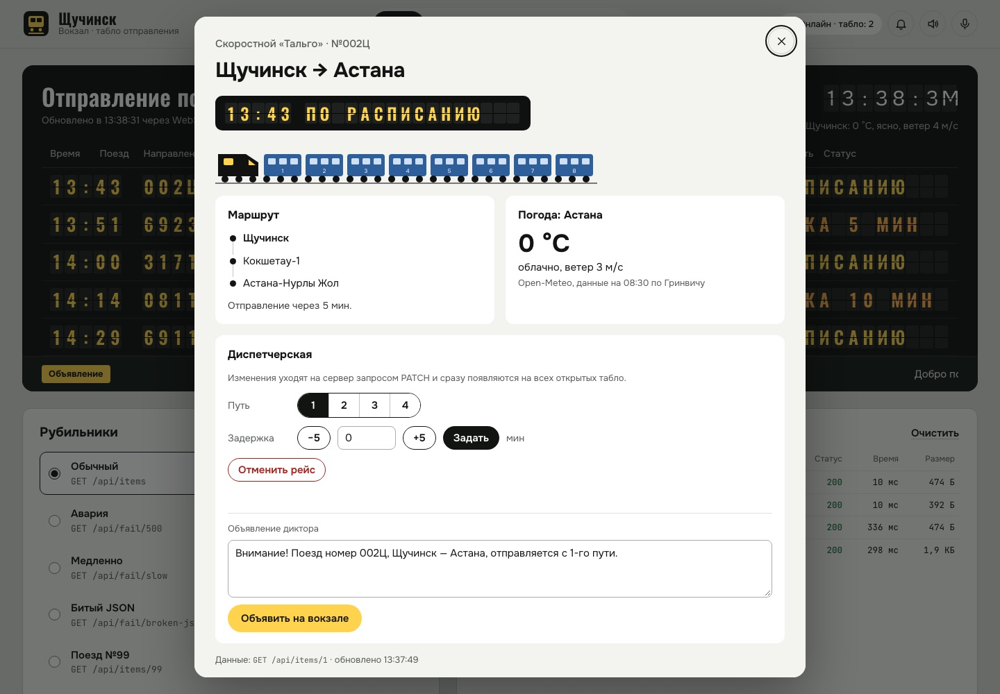
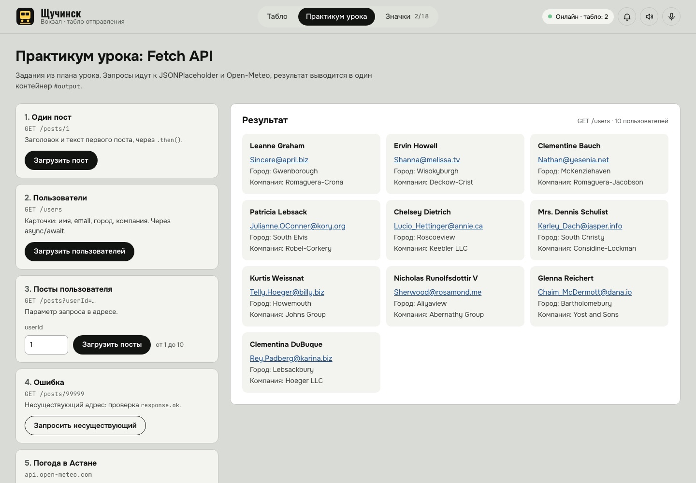
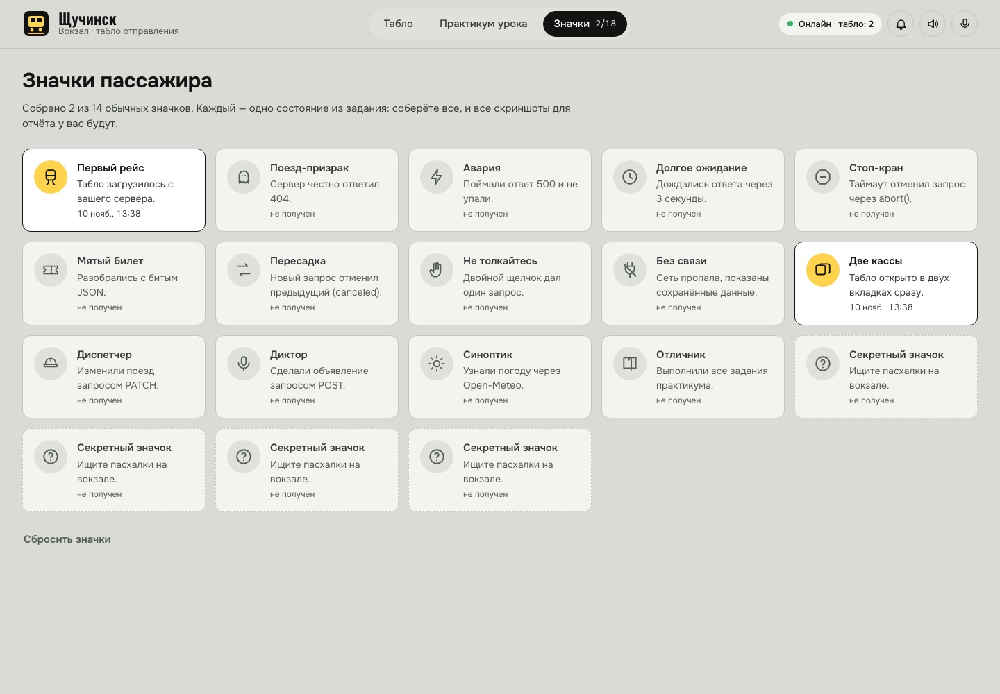

# Вокзал Щучинск — табло отправления

Самостоятельная работа по ПМ6 «Fetch API: GET-запросы к REST API и отправка данных (POST, JSON)». Группа ПО-33.

Это табло вокзала с перекидными буквами. Данные о пяти поездах приходят с собственного сервера на Express. Раз в 5 секунд сервер присылает обновления по WebSocket. В диспетчерской можно поменять путь и задержку (`PATCH`) или сделать объявление (`POST`), и это сразу увидят все открытые табло. Отдельная вкладка — практикум урока: пост, пользователи, параметры запроса, ошибка 404 и погода в Астане.



## Как запустить

Нужен Node.js 18 или новее.

```bash
npm install
npm start
```

Откройте http://localhost:3000. Вместо `npm start` можно запустить `node server.js`. Остановить сервер: Ctrl+C.

Открывать `public/index.html` двойным щелчком не нужно: страница скажет, что ей нужен сервер.

## Структура

```
server.js          сервер: Express + WebSocket на порту 3000
public/
  index.html       страница: табло, практикум, значки
  style.css        оформление
  api.js           requestJSON(): проверка ответа, таймаут, отмена, защита от дублей, журнал «Сеть»
  flap.js          перекидные буквы
  board.js         табло: рубильники, кэш, WebSocket, карточка поезда, диспетчерская
  script.js        практикум урока (JSONPlaceholder, Open-Meteo), вывод в #output
  fun.js           звуки, голос диктора, значки, пасхалки
screenshots/       скриншоты всех состояний
```

## Эндпоинты

| Метод | Адрес | Ответ |
|---|---|---|
| GET | `/api/items` | массив из 5 поездов |
| GET | `/api/items/:id` | один поезд или **404** `{ "error": "Поезд не найден" }` |
| PATCH | `/api/items/:id` | изменить поезд, тело JSON: `{ "platform": 1–4, "delay": 0–999, "cancelled": true/false }`; неверные значения — **400** |
| POST | `/api/announcements` | объявление диктора, тело JSON: `{ "text": "..." }`, ответ **201** |
| GET | `/api/fail/500` | рубильник: всегда **500** |
| GET | `/api/fail/slow` | рубильник: ответ через **3 секунды** |
| GET | `/api/fail/broken-json` | рубильник: **битый JSON** со статусом 200 |
| GET | `/api/...` любой другой | **404** в формате JSON |

Пример поезда:

```json
{
  "id": 1,
  "number": "002Ц",
  "type": "Скоростной «Тальго»",
  "to": "Астана",
  "stops": ["Щучинск", "Кокшетау-1", "Астана-Нурлы Жол"],
  "wagons": 8,
  "lat": 51.18,
  "lon": 71.45,
  "departure": "2026-11-10T08:43:00.000Z",
  "platform": 1,
  "delay": 0,
  "cancelled": false,
  "status": { "code": "scheduled", "text": "По расписанию" },
  "updatedAt": "2026-11-10T08:37:00.000Z"
}
```

Время отправления считается от момента запуска сервера: первый поезд уходит через 6 минут. Поэтому во время демонстрации статусы меняются на глазах: «По расписанию», потом «Посадка», потом «Отправлен». Ушедший поезд через 2 минуты получает новый рейс. Расписание и номера поездов учебные, это не настоящее расписание.

### WebSocket

Адрес `ws://localhost:3000`, тот же порт, что у сайта. Сервер присылает сообщения:

| `type` | Когда | Что внутри |
|---|---|---|
| `hello` | сразу после подключения | `items`, `clients` |
| `update` | раз в 5 секунд и после каждого PATCH | `items`, `changed` (id изменившихся поездов), `reason`: `tick` или `dispatcher`, `at` |
| `clients` | кто-то подключился или отключился | `count`: сколько табло открыто |
| `announce` | после POST /api/announcements | `text`, `at` |

Клиент сам переподключается, если связь пропала: через 1, 2, 4… секунд, максимум через 15.

## Уровни задания

**Уровень 1. Свой сервер.**
- `server.js` на Express отдаёт статику из `public/`.
- Эндпоинты `GET /api/items` (5 поездов) и `GET /api/items/:id` (поезд или 404).

**Уровень 2. Проект на своём сервере.**
- Табло берёт данные только с `http://localhost:3000/api/...`.
- Каждый запрос сервер пишет в терминал: время, метод, путь, статус и длительность. Запрос, отменённый клиентом, тоже виден: «отменён клиентом».

**Уровень 3. Рубильники.** Блок «Рубильники» под табло: 500, медленно (3 с), битый JSON, а ещё поезд №99 (404). Для каждого случая есть:
- индикатор «Загрузка...» — пластинки на табло шуршат;
- понятное сообщение;
- кнопка «Повторить».

**Уровень 4. Отмена и дубли** — функция `requestJSON()` в `public/api.js`:
- новый запрос отменяет предыдущий через `AbortController`. Например, включите «Медленно» и сразу «Обычный»: в Network медленный запрос будет помечен `(canceled)`;
- таймаут — настоящий `abort()` через `setTimeout`, без `Promise.race`. Выберите «Таймаут: 2 секунды» и рубильник «Медленно»;
- двойной щелчок по «Обновить табло» даёт один запрос: пока он в пути, второй щелчок получает тот же промис.

**Уровень 5. Кэш и офлайн.**
- Последний удачный ответ хранится в `localStorage` с меткой времени (ключ `vokzal-cache`).
- При ошибке сети табло показывает кэш и плашку «Нет связи, показаны сохранённые данные».
- Кэш старше 5 минут не показывается.

**Уровень 6. WebSocket.**
- Сервер на пакете `ws` работает на том же порту и раз в 5 секунд шлёт `{ type: "update", ... }`.
- Табло обновляется само, без кнопки.
- Изменение в диспетчерской одной вкладки сразу видно во второй.

**Уровень 7.** Этот README.

### Значки

Во вкладке «Значки» 14 обычных значков, и каждый — одно состояние из задания: 404, 500, таймаут, битый JSON, отмена, двойной щелчок, офлайн, две вкладки, PATCH, POST и т. д. Если собрать все, то каждое состояние вы хотя бы раз увидели, и скриншоты для отчёта можно сделать по ходу.

## Скриншоты состояний

| Состояние | Скриншот |
|---|---|
| Успех |  |
| 404 |  |
| 500 |  |
| Таймаут |  |
| Битый JSON |  |
| Офлайн, показан кэш |  |
| WebSocket, две вкладки |  |
| Карточка поезда и диспетчерская |  |
| Практикум урока |  |
| Значки |  |

Офлайн на скриншоте снят так: табло обращалось к закрытому порту, то есть это настоящая сетевая ошибка. Для сдачи снимите его ещё раз по заданию: DevTools → Network → Offline → «Обновить табло».

Эти скриншоты нужно снять самостоятельно, их нельзя сделать без вашего компьютера:
1. Ответы `/api/items` и `/api/items/99` в Postman или Thunder Client.
2. Терминал сервера с логом запросов.
3. DevTools → Network: запрос `(canceled)` после переключения рубильника и один запрос после двойного щелчка.
4. DevTools → Network → Offline: табло не пустое, плашка есть.

## Практикум урока

Вкладка «Практикум урока» выполняет задания из плана урока. Все результаты выводятся в `<div id="output">`, код лежит в `public/script.js`.
1. «Загрузить пост»: `GET /posts/1` через `.then()`, на экране заголовок и текст.
2. Пользователи: `GET /users`, карточки с именем, email, городом и компанией. Сделано через async/await.
3. Посты пользователя: поле `userId` и запрос `GET /posts?userId=...`.
4. Ошибка: `GET /posts/99999`, проверка `response.ok`, понятное сообщение и «Повторить».
5. Погода в Астане через Open-Meteo: температура и ветер.

## Что ещё есть

- Перекидные буквы, которые щёлкают при каждом изменении.
- Часы на табло и текущая погода в Щучинске.
- Карточка поезда по щелчку (`GET /api/items/:id`): состав (локомотив и вагоны), маршрут, погода в городе назначения.
- Диспетчерская в карточке: путь, задержка, отмена рейса (`PATCH`), объявление диктора (`POST`). Объявление пробегает строкой, звучит вокзальный сигнал, и его читает голос (Web Speech API).
- Блок «Сеть» — мини-версия DevTools → Network: метод, адрес, статус, время, размер и пометка `(canceled)`.
- Звуки синтезируются в коде (Web Audio). Звук и голос выключаются кнопками вверху.
- Удобно с клавиатуры и с телефона: на узком экране табло перестраивается.

<details>
<summary>Пасхалки (не открывайте, если хотите найти сами)</summary>

- Код Konami (↑ ↑ ↓ ↓ ← → ← → B A): на нулевой путь подают ночной экспресс до Луны.
- Напечатайте «чух» на клавиатуре: по экрану проедет паровоз.
- Пять быстрых щелчков по часам на табло: время пойдёт назад.
- Задержка 404, 500 или 777 минут в диспетчерской: на табло появится шутка.
- Колокол в верхней панели звонит.
- Если открыть табло ночью, оно напомнит, что буфет закрыт.
</details>

## Ограничения

- Состояние поездов хранится в памяти сервера. После перезапуска расписание начинается заново.
- Погода берётся из Open-Meteo и кэшируется на 10 минут. Без интернета табло работает, но погоды не будет.
- Голос диктора зависит от браузера: в Chrome и Safari русский голос обычно есть.
- Проверялось в Chrome.
